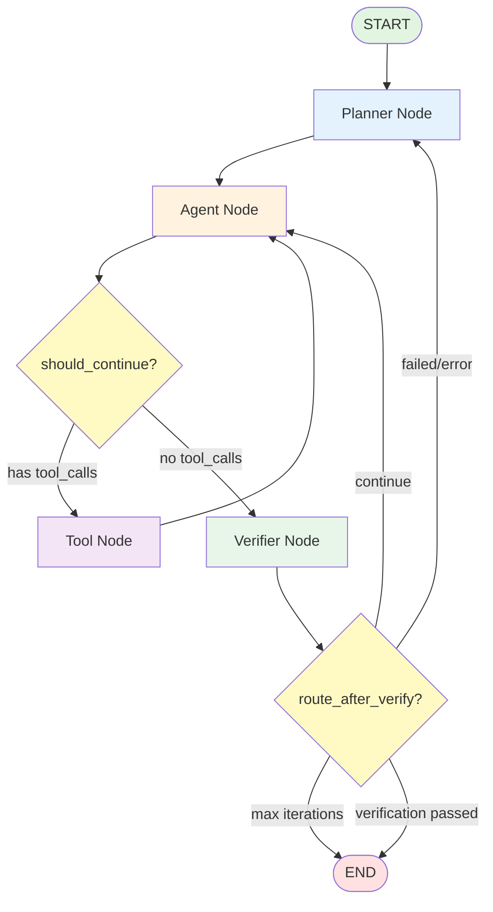

# LangGraph Agent API with FastAPI

FastAPI server với LangGraph agent integration - kết hợp pattern từ lession2.

## Tính năng

- ✅ **LangGraph State Machine**: Agent loop với state management
- ✅ **Tool Execution**: Shell command execution với guardrails
- ✅ **FastAPI Integration**: REST API endpoints
- ✅ **Streaming Support**: Server-Sent Events (SSE) cho real-time updates
- ✅ **Health Checks**: Monitoring endpoints

## Kiến trúc

```
┌─────────────┐
│   FastAPI   │ ← HTTP Request
└──────┬──────┘
       │
       ▼
┌─────────────┐
│  LangGraph  │ ← State Machine
│    Agent    │
└──────┬──────┘
       │
       ▼
┌─────────────┐
│   Claude    │ ← LLM
│     API     │
└─────────────┘
```

## Cài đặt

1. Clone repository
2. Cài đặt dependencies:
   ```bash
   uv sync
   ```

3. Tạo file `.env`:
   ```bash
   cp .env.example .env
   ```

4. Cập nhật `.env` với API key:
   ```
   ANTHROPIC_API_KEY=your_actual_api_key
   ANTHROPIC_API_URL=https://api.anthropic.com
   ANTHROPIC_MODEL=claude-3-5-sonnet-20241022
   ```

## Sử dụng

### Option 1: FastAPI Server

```bash
# Start server
uv run python main.py
```

Server chạy tại `http://localhost:8000`

Test API:
```bash
curl http://localhost:8000/health
curl -X POST http://localhost:8000/agent/run \
  -H "Content-Type: application/json" \
  -d '{"task": "Liệt kê tất cả file Python"}'
```

### Option 2: Direct Client (giống lession2)

```bash
# Chạy agent trực tiếp với jq formatting
uv run python client.py
```

Client sẽ chạy 3 tasks demo và hiển thị kết quả với jq.

### Option 3: Standalone Agent

```bash
# Chạy agent.py trực tiếp (có thể import vào code khác)
uv run python -c "from agent import run_agent; print(run_agent('List files'))"
```

### Utilities

```bash
# Validation
uv run python validate.py

# Test suite
uv run python test-agent.py
```

#### Health Check
```bash
curl http://localhost:8000/health
```

#### Run Agent (blocking)
```bash
curl -X POST http://localhost:8000/agent/run \
  -H "Content-Type: application/json" \
  -d '{"task": "List all Python files in this directory"}'
```

#### Stream Agent (SSE)
```bash
curl -N http://localhost:8000/agent/stream \
  -H "Content-Type: application/json" \
  -d '{"task": "List all Python files in this directory"}'
```

## Agent Components

### 1. State Management (LangGraph)

```python
class AgentState(TypedDict):
    messages: Annotated[list, add_messages]
    turn_count: int
```

### 2. Agent Loop

```
START → agent_node → should_continue?
           ↑              ↓
           └─── tool_node ← (if tools)
                    ↓
                   END (if no tools)
```

### 3. Termination Conditions

- **Natural stop**: Model không gọi thêm tool
- **Budget stop**: Đạt max turns (default: 10)

### 4. Guardrails

- Chỉ cho phép read-only commands: `ls`, `cat`, `grep`, `wc`, `head`, `find`, `pwd`
- Timeout: 10 giây
- Output limit: 4000 ký tự

## So sánh với Lession2

| Feature | Lession2 (Minimal) | Lession3 (LangGraph + FastAPI) |
|---------|-------------------|--------------------------------|
| Agent Loop | Manual while loop | LangGraph state machine |
| State Management | List of dicts | TypedDict với StateGraph |
| Tool Execution | Direct function call | Tool binding với LangChain |
| API | None | FastAPI với REST + SSE |
| Streaming | None | Server-Sent Events |
| Checkpointing | None | Built-in với LangGraph |

## Cấu trúc Project

```
lession3/
├── main.py            # Entry point (start FastAPI server)
├── api.py             # FastAPI layer (HTTP endpoints)
├── agent.py           # LangGraph core (state machine + tools)
├── client.py          # Agent client với jq formatting
├── test-agent.py      # Test suite
├── validate.py        # Validation script
├── pyproject.toml     # Dependencies
├── .env.example       # Environment template
└── README.md          # Documentation
```

### Agent Flow

**LangGraph State Machine:**



**Nodes:**
- `planner_node`: Tạo plan hoặc replan khi có error
- `agent_node`: Gọi LLM với tools dựa trên plan
- `tool_node`: Execute tools (shell, database) với validation
- `verifier_node`: Kiểm tra task completion và detect errors

**Routing Logic:**
- `should_continue`: agent → tools (nếu có tool_calls) hoặc verifier
- `route_after_verify`: verifier → planner (replan) | agent (continue) | END

**Termination Conditions:**
- Natural stop: Model không gọi thêm tool và verifier pass
- Budget stop: Đạt MAX_ITERATIONS (default: 1)
- Error stop: Verifier detect error và trigger replan

**Tools:**
- `run_shell_tool`: Shell commands (ls, cat, grep, wc, head, find, pwd)
- `query_db`: Execute SQL queries
- `list_tables`: List database tables

**Integration Flow:**

```
Cách 1: Qua API
  main.py (uvicorn) → api.py (FastAPI) → agent.py (LangGraph)

Cách 2: Direct client
  client.py → agent.py (LangGraph)
```

## Dependencies

- `fastapi`: Web framework
- `uvicorn`: ASGI server
- `langgraph`: State machine cho agents
- `langchain-anthropic`: Claude integration
- `python-dotenv`: Environment variables

## Advanced Usage

### Custom Tools

Thêm tools mới trong `agent.py`:

```python
def your_custom_tool(arg: str) -> str:
    """Your tool description"""
    # Implementation
    return result

# Bind to LLM
tools = [run_shell_tool, your_custom_tool]
llm_with_tools = llm.bind_tools(tools)
```

### Checkpointing (Memory)

LangGraph hỗ trợ checkpointing để agent nhớ context:

```python
from langgraph.checkpoint.memory import MemorySaver

memory = MemorySaver()
graph = workflow.compile(checkpointer=memory)
```

### Human-in-the-Loop

Thêm human approval node:

```python
def should_continue(state):
    if needs_approval:
        return "human"  # Wait for human input
    return "continue"
```

## Troubleshooting

### Import errors
```bash
# Đảm bảo đang dùng virtual environment
uv sync
source .venv/bin/activate  # hoặc .venv\Scripts\activate trên Windows
```

### API key not found
```bash
# Kiểm tra .env file
cat .env
# Đảm bảo không có khoảng trắng: ANTHROPIC_API_KEY=sk-...
```

### Port already in use
```bash
# Thay đổi port trong api.py
uvicorn.run("api:app", host="0.0.0.0", port=8001)
```

## Tham khảo

- [LangGraph Docs](https://langchain-ai.github.io/langgraph/)
- [FastAPI Docs](https://fastapi.tiangolo.com/)
- [Anthropic Claude API](https://docs.anthropic.com/)
- [Session 2 Materials](../lession2/)
